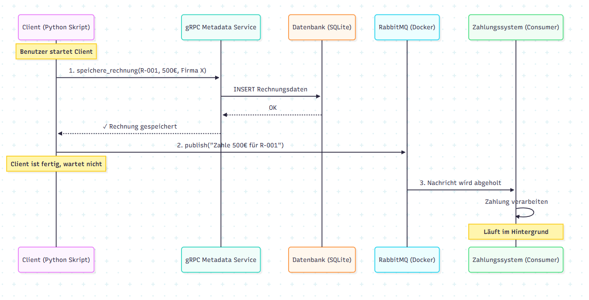

# Sprint 1

In diesem Projekt präsentieren wir die 1. Abgabe (Sprint 1) des DVG Moduls

In diesem ersten Sprint des DVG-Moduls haben wir die Basiskomponenten für ein automatisiertes Rechnungsverarbeitungssystem entwickelt. 
Ziel ist es, Medienbrüche im aktuellen Prozess zu reduzieren und die manuelle Datenerfassung zu minimieren.

## Technologien
* **Programmiersprache:** Python
* **Kommunikation:** gRPC, RabbitMQ
* **Datenbank:** SQLite
* **Containerisierung:** RabbitMQ läuft via Docker

## Installation & Ausführung

1. Docker Container starten: `docker run -d --name rabbitmq -p 5672:5672 rabbitmq`
2. gRPC Server starten: `python server.py`
3. Client ausführen: `python client.py`

