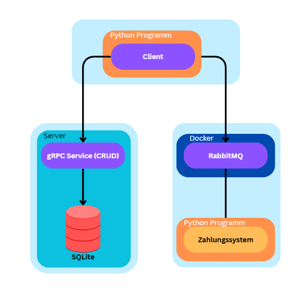

# Rechnungsverarbeitungssystem (Sprint 1 + Sprint 4)

In Sprint 1 wurden die Basiskomponenten für ein automatisiertes
Rechnungsverarbeitungssystem entwickelt (gRPC-Service, Zahlungssystem über
Messaging, Client). Ziel ist es, Medienbrüche im aktuellen Prozess zu reduzieren
und die manuelle Datenerfassung zu minimieren.

In Sprint 4 wird der Prozess als Workflow auf Camunda 8 (Zeebe) automatisiert.
Ein Zeebe Job Worker bindet die Sprint-1-Komponenten an: Er speichert die
Metadaten per gRPC und veranlasst die Zahlung über RabbitMQ. Der Worker löst den
manuellen Terminal-Client ab – die Rechnungsdaten kommen jetzt aus dem
Camunda-Workflow statt aus der Tastatureingabe.



## Installation & Ausführung

### 1. Virtual Environment erstellen und aktivieren

```bash
python -m venv venv

.\venv\Scripts\Activate.ps1   # Windows
source .venv/bin/activate     # Mac
```

### 2. Abhängigkeiten installieren

```bash
pip install -r requirements.txt
```

### 3. gRPC Vertrag generieren (für jeden service ordner einzeln)

```bash
# Im Client ordner
cd client
python -m grpc_tools.protoc -I. --python_out=. --grpc_python_out=. protos/invoice.proto

# Im gRPC Server ordner
cd ../grpc
python -m grpc_tools.protoc -I. --python_out=. --grpc_python_out=. protos/invoice.proto
```

### 4. RabbitMQ starten (Docker)

```bash
cd zahlungsservice/RabbitMQ
docker build -t rabbitmq-dvg .
docker run -d --name rabbitmq-dvg -p 5672:5672 -p 15672:15672 rabbitmq-dvg
```

### 5. Backend-Services starten (jeweils in einem eigenen Terminal)

```bash
# Terminal 1: gRPC Server
cd grpc
python server.py

# Terminal 2: Zahlungsservice
cd zahlungsservice
python payment_system.py
```

Der Client (`client/client.py`) kann weiterhin manuell zum Testen genutzt
werden, wird im Workflow-Betrieb aber durch den Worker ersetzt.

## Sprint 4 – Zeebe Job Worker

Der Worker (`worker/worker.py`) verbindet sich mit dem Camunda 8 Cluster und
bearbeitet zwei automatisierte Schritte des Workflows:

- `g3-save-metadata`   – speichert die Metadaten per gRPC (Sprint-1-Service)
- `g3-execute-payment` – veranlasst die Zahlung über RabbitMQ (Sprint-1-Service)

Der Worker baut eine ausgehende Verbindung zum Cluster auf und holt sich die Jobs
selbst (Long Polling). Es ist keine eingehende Verbindung auf den Rechner nötig.

### 6. Credentials hinterlegen (.env)

Eine Datei `.env` im Root-Verzeichnis anlegen mit den
Cluster-Credentials.
```
ZEEBE_CLIENT_ID=...
ZEEBE_CLIENT_SECRET=...
ZEEBE_CLUSTER_ID=...
ZEEBE_REGION=...
JOB_TYPE_METADATA=g3-save-metadata
JOB_TYPE_PAYMENT=g3-execute-payment
```

### 7. Verbindung testen (optional, empfohlen)

Prüft nur die Cluster-Anbindung, ohne gRPC/RabbitMQ:

```bash
cd worker
python test_connection.py
```

Läuft ohne Auth-Fehler durch und wartet → Verbindung steht (mit Strg+C beenden).

### 8. Worker starten

Voraussetzung: gRPC-Server, RabbitMQ und Zahlungsservice laufen (Schritte 4–5).

```bash
cd worker
python worker.py
```

Der Worker verbindet sich mit dem Cluster und wartet auf Jobs. Sobald der
Camunda-Workflow einen der Service Tasks erreicht, wird der jeweilige Job
abgearbeitet. Beenden mit Strg+C.

## Nachrichtenformat (RabbitMQ)

```json
{
    "invoiceName": "R-001",
    "amount": 500.00,
    "currency": "EUR",
    "recipient": "Firma X",
    "timestamp": "2026-04-10T14:30:00"
}
```


